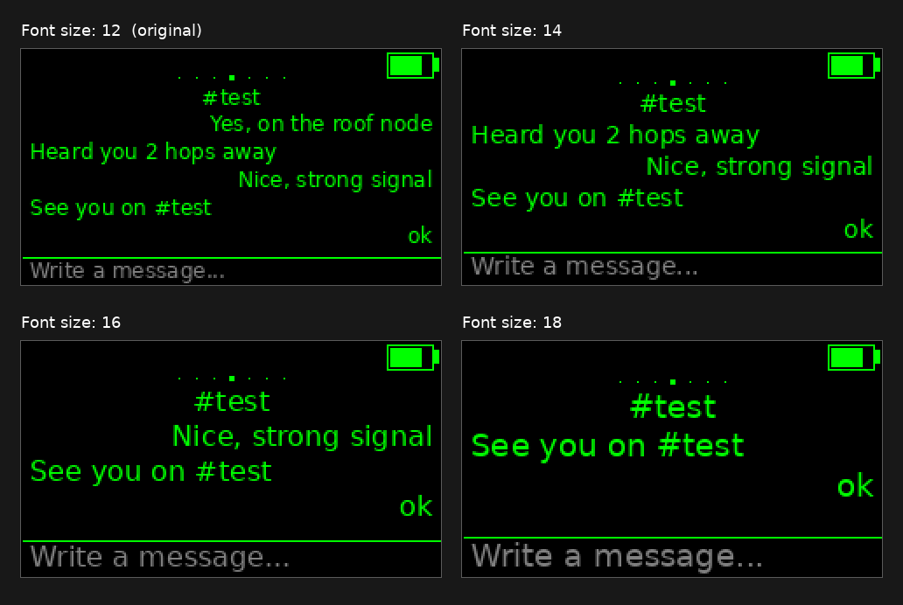
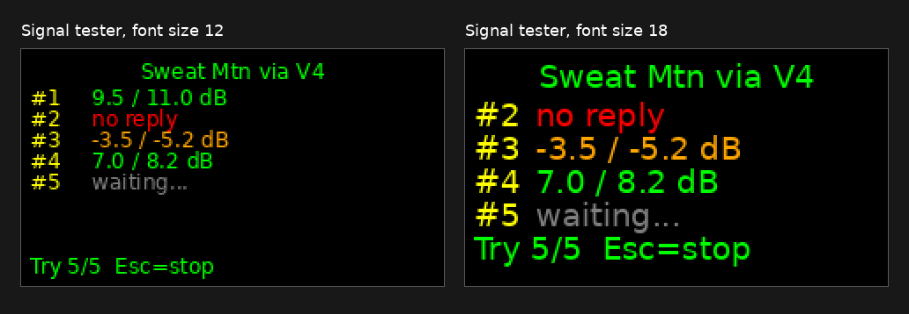

## MeshCore Cardputer-Adv + Cap LoRa-1262 variant, with a font size setting and a signal tester

This is a fork of [MultiMote/meshcore-cardputer-adv](https://github.com/MultiMote/meshcore-cardputer-adv)
that adds two things: **Settings > Font size** and **Tools > Signal tester**. The original firmware draws
everything in a 12 px font, which is hard to read on the Cardputer's small screen. This fork keeps everything else
as it is (phone pairing over Bluetooth, SD card history, GPS, keyboard layouts), lets you pick a bigger font on the
device itself, and lets you measure the link to a repeater without a phone or PC.



*Rendered preview of the chat page at each size (a drawing, not a photo of the device).*

### Font size

- Press `OPT` on the main screen, go to **Font size** under DEVICE and press `Enter`.
- `Left` / `Right` switch between **12** (original), **14**, **16** and **18** px. The screen redraws at once so you can judge it.
- `Enter` saves the choice, `Esc` goes back to the previous size.
- The whole interface follows the font: menus, contact and channel lists, chat history and the message line.
  Bigger text means fewer rows on screen. At 18 px the chat shows two messages plus the input line, at 16 px three.
- The setting is stored with the other custom settings on the SD card (`/meshcore_custom/prefs`), so it survives
  firmware updates. A settings file written by the original firmware is read as it is; the font simply starts at 12 px.

All four fonts are DejaVu Sans with the same character set as the original (Latin, Latin-1, Latin Extended-A,
Cyrillic, currency symbols, arrows). They are generated from the DejaVu TTF with `tools/make_vlw_font.py` and
compiled into the firmware, which grows by about 320 KB.

### Signal tester

Tests the radio link to a repeater, straight from the device: five traces, ten seconds apart, with the signal-to-noise
ratio of each one. Handy when you place an antenna or want to know whether a distant repeater hears you.



*Rendered preview of the result page (a drawing, not a photo of the device).*

- Press `OPT` twice (or open the Tools screen), pick **Signal tester** and press `Enter`.
- Choose the repeater to test from your contacts.
- Choose **(direct, no repeater)** to test it over one hop, or pick another repeater to go through first. Testing a
  distant repeater *via* your own repeater tells you whether the two of them hear each other.
- Each line shows one try: the SNR heard **there** (at the tested repeater) and on the way **back** (at the repeater
  you went through, or at the device for a direct test). Green when both are positive, orange when a hop is below
  zero, red when nothing came back within ten seconds.
- The last line counts the replies. `Esc` stops a running test, `Enter` runs it again.

A reply needs every hop to work in both directions, so "no reply" on a path that you *can* hear means the other
side does not hear you, or does not relay.

### Installing this fork

1. Download the `-merged.bin` file from the [Releases](https://github.com/opensourcera/meshcore-cardputer-adv/releases) page.
2. Flash it at address `0x0` with https://meshcore.io/flasher or esptool:

   ```bash
   esptool --chip esp32s3 --port COMx write-flash 0x0 cardputer_adv_companion_radio_ble-<version>-merged.bin
   ```

3. Your node identity, contacts, channels and chat history live on the SD card and are kept.

Everything below is the original project's README.

---


This variant designed to not change the original codebase. I tried to make the implementation as clean as possible.

### Building

MeshCore is included as a git submodule, so clone with submodules (or fetch them first):

```bash
git clone --recurse-submodules https://github.com/MultiMote/meshcore-cardputer-adv.git
# or, in an existing clone:
git submodule update --init --recursive
```

Build:

```bash
platformio run --environment cardputer_adv_companion_radio_ble
```

Build and flash:

```bash
platformio run --target upload --environment cardputer_adv_companion_radio_ble
```

### Flashing pre-build binaries

1. Grab .bin file from [Releases](https://github.com/opensourcera/meshcore-cardputer-adv/releases) page (this fork) or the [upstream releases](https://github.com/MultiMote/meshcore-cardputer-adv/releases). The "merged" firmware will not erase your settings because they are stored on the SD card.
2. Flash with https://meshcore.io/flasher or with any other ESP32S3 flaser.

### State

> [!WARNING]
> Firmware is under development. Some settings may reset after flashing a new version. Back up your data if you don't want to lose anything.

Currently implemented (companion):

- Cap LoRa-1262 initialization (+ port extender)
- BLE connection
- GPS support
- GPS power management with CAS commands (Cap LoRa-1262 does not have a GPS switch pin)
- Store data to SD card
  * All default MeshCore settings (data is not grouped into single directory because the default paths are hardcoded)
  * Custom settings, chat history (`meshcore_custom` directory)
- Basic speaker support (keyboard/message beeps)
- Keyboard support
- Settings menu (press `OPT` at main screen)
- Tools menu (press `T` at main screen)
   * Advert (flood / zero hop)
   * Discover repeaters (testing)
- Power optimizations
   - Light sleep
      * Power consumption drops to ~22mA after display off
      * Can be enabled in settings menu
      * Bluetooth connection is not preserved
   - Audio codec power control
- Battery ADC correction
- Channels list
   * Press `Enter` on channel to start conversation
- Contacts list
   * Press `Enter` on repeater/room to ping
   * Press `Enter` on contact to start conversation
   * Press `Ctrl+R` to reset path
- Compose and send messages
   * After sending group message, "Heard repeats" appears (if any)
   * After sending direct message, "Message delivered" appears (if ACK received)
   * Retry direct message sending if ACK is not received
   * Press `Ctrl+Up` to insert last sent message into the text field
   * Press `Ctrl+T` to break resending

- Chat history
   * Full history stored on SD card
   * Last 15 messages stored in buffer
   * When contact/channel is selected, history is loaded from SD card
   * Press `Up`/`Down` to scroll
- Unread counter
   * On main screen
   * Near contact/channel
- Basic display unicode support. Font is `DejaVu Sans`, 12 px converted with `Processing 4` to vlw format; 14, 16 and 18 px generated with `tools/make_vlw_font.py` (this fork).

  Included unicode blocks:
   * Basic Latin (U+0000-U+007F)
   * Latin-1 Supplement (U+0080-U+00FF)
   * Latin Extended-A (U+0100-U+017F)
   * Cyrillic (U+0400-U+04FF)
   * Currency Symbols (U+20A0-U+20CF)
   * Arrows (U+2190-U+21FF)

- Keyboard layouts

   * Enabled if `/meshcore_custom/keyboard_alt.txt` file is present on SD card
   * Switch with Ctrl+Space
   * Create own layout with [Layout Editor](https://github.com/MultiMote/cardputer-adv-layout-editor).
   * Up to 3 byte character replacement (UTF-8)
   * Ready to use: [keyboard_layouts](keyboard_layouts)
   * More info: https://github.com/MultiMote/meshcore-cardputer-adv/wiki/Keyboard-layout-format


Todo:

- Change display brightness
- Custom notification sounds (.wav files from SD card)
- Import contacts from SD card
- Delete contacts
- Add hash channels

### Thoughts on Cardputer

Due to the high power consumption of this device, I don't think it's a good choice for always-on MeshCore companion.

It draws about 130-180 mA in idle state.

I also don't quite understand the decisions made by M5Stack:

1. GPS is always on in the Cap LoRa-1262 as ON/OFF pin is connected to 3.3v. Cap LoRa-1262 has IO expander IC (PI4IOE) with 7 unused pins. Why not use them?

   

2. To enable radio, you need to set P0 of IO expander IC to high level. Without this, FM8625H remains unpowered.
   Usually radio might be damaged when antenna is not connected during transmission.

   

   

3. Cardputer has 1750mAh battery, but PROG resistor of TP4057 is 3.3k. Maximum charge current is 303mA.
   Also Cardputer charges only if power switch is on.

   

